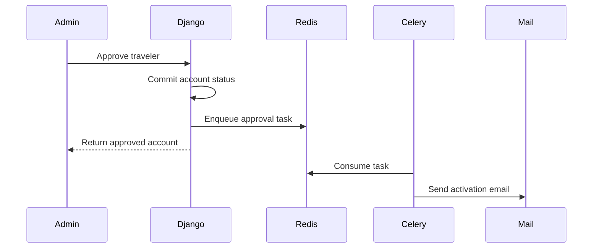

# AirBooking

AirBooking is a flight booking application built with React, Django REST Framework and Celery. Travelers register for an account, wait for admin approval, search flight inventory, book seats with simulated payment and manage reservations in My Trips. The React admin dashboard handles account review, flight CRUD, flight status and booking statistics.

- **Approval and access.** New accounts start pending. Approved users sign in with a username and password. The API uses short-lived JWT access tokens and rotating refresh tokens. An approval email is dispatched through Celery after the database transaction commits.
- **Search and booking.** Search by origin, destination, departure date, travellers and cabin class. The traveller picker separates adults (12+), children (2 to under 12) and infants (under 2), with up to nine travellers and one accompanying adult per infant. Each traveller reserves one seat at the listed fare. Cabin choices include Economy, Premium Economy, Business Class and First Class, with benefit descriptions. Admins assign each flight inventory record a cabin class; existing flights default to Economy. Traveller counts carry into booking and appear in My Trips. The API reserves seats in a transaction, calculates the booking total from the stored fare and assigns a unique confirmation reference.
- **My Trips and status.** The flight details and active-trip screens poll every 30 seconds. AirLabs can supply a live status for matching real flight instances. Local flight updates are labeled **AirBooking stored status**, distinct from **AirLabs live**. Legacy sample markers are omitted from displayed meal names without rewriting purchase records. Payments and refunds remain clearly labeled as simulated.
- **Complaints.** The sidebar's Complaints section lets users submit a subject and message and view their private complaint history. Admins can review all submissions, sender details and submission dates in the dashboard's Complaints tab. Run database migrations after updating the app to create the complaint table.
- **Extras.** Travelers can cancel eligible reservations, restoring available seats and marking payments as refunded. A simulated decline makes the payment error path testable. Request IDs protect against accidental duplicate bookings. Admins can monitor pending registrations, flights, confirmed bookings and reserved seats.

## Project structure

| Path | Contents |
| --- | --- |
| `backend/config/` | Django settings, URL entry point and Celery configuration |
| `backend/booking/` | User, flight and booking models, serializers, APIs, tasks and AirLabs integration |
| `backend/booking/migrations/` | Database migrations |
| `backend/booking/tests.py` | API integration tests |
| `frontend/src/` | React routes, traveler and admin screens, API client and styles |
| `docs/API.md` | Endpoint reference, request examples and response behavior |

## Run locally in VS Code on Windows

Use Python 3.12 and Node.js 22.12+ or Node.js 24. Open the extracted `AirBooking` folder in VS Code. Run these commands in two PowerShell terminals from the project root.

### Terminal 1 · Django API

```powershell
cd backend
py -3.12 -m venv .venv
.\.venv\Scripts\python.exe -m pip install -r requirements.txt
Copy-Item .env.example .env
.\.venv\Scripts\python.exe manage.py migrate
.\.venv\Scripts\python.exe manage.py seed_demo
.\.venv\Scripts\python.exe manage.py runserver 127.0.0.1:8000
```

The default setup uses SQLite and needs no separate database server. The seed command creates the demo reviewer and five sample flights departing one to three days ahead. You can rerun it for fresh dates.

### Terminal 2 · React app

```powershell
cd frontend
Copy-Item .env.example .env
npm.cmd ci
npm.cmd run dev
```

Open [http://localhost:5173](http://localhost:5173). The API base is [http://127.0.0.1:8000/api](http://127.0.0.1:8000/api). API routes are listed in [the API reference](docs/API.md). Keep both terminals running.

On macOS or Linux, use `python3 -m venv .venv`, `.venv/bin/python`, `cp .env.example .env`, and `npm` in the corresponding commands.

## Sample walkthrough

1. Open **Create an account** and register a traveler. Sign in with that account to see the pending approval message.
2. Sign in with the local admin username **evaluator** and password **AirBooking-Demo-482!**.
3. In **Pending registrations**, approve the traveler. The approval email appears in the Django terminal with the default console email backend.
4. Open the admin **Flights** tab and set flight **AB217** to **Delayed**.
5. Sign out and sign in as the traveler. Search from **COK** to **BLR** and open AB217.
6. Select **Continue to payment** to open the payment simulation page. Review the itinerary, travellers and total, then select Card, UPI or Net Banking. Try **Declined payment**, then **Successful payment** and select **Pay (simulated)**. No real payment details or money are used. On success, **My Trips** displays the reservation and its confirmation reference. Retrying the same checkout keeps its request ID to prevent duplicate bookings.
7. Select **Cancel trip**, choose a common cancellation reason or type your own, then confirm. My Trips shows the saved reason and simulated refund, and the released seat becomes available again.

To create an administrator with your own credentials, run `manage.py createsuperuser` with the virtual environment's Python. Superusers can sign in directly.

## Environment configuration

Copy each `.env.example` in its own directory. The frontend reads its settings when Vite starts or builds.

| Variable | Purpose |
| --- | --- |
| `DJANGO_DEBUG`, `DJANGO_SECRET_KEY`, `DJANGO_ALLOWED_HOSTS` | Backend debug mode, signing secret and allowed hosts. Set a generated secret and disable debug for a shared deployment. |
| `CORS_ALLOWED_ORIGINS` | Comma-separated browser origins, including scheme and port. Add the frontend origin if it changes. |
| `POSTGRES_DB`, `POSTGRES_USER`, `POSTGRES_PASSWORD`, `POSTGRES_HOST`, `POSTGRES_PORT` | Use PostgreSQL instead of the local SQLite file. Create the database, set these variables and run `manage.py migrate`. |
| `CELERY_TASK_ALWAYS_EAGER`, `CELERY_BROKER_URL` | Run tasks inline locally or send them to a Redis-backed Celery worker. |
| `EMAIL_BACKEND`, `DEFAULT_FROM_EMAIL`, `EMAIL_HOST`, `EMAIL_PORT`, `EMAIL_HOST_USER`, `EMAIL_HOST_PASSWORD`, `EMAIL_USE_TLS` | Configure approval email. Defaults print emails to the process console. |
| `AIRLABS_API_KEY` | Server-side key for the AirLabs Flight Information API. |
| `VITE_API_URL` | Django API base URL, including `/api`. |

### Queue approval email with Redis

Start a local Redis instance. For example, with Docker running:

```powershell
docker run --rm --name airbooking-redis -p 127.0.0.1:6379:6379 redis:7-alpine
```

Set the following in `backend/.env`, then restart Django.

```dotenv
CELERY_TASK_ALWAYS_EAGER=false
CELERY_BROKER_URL=redis://127.0.0.1:6379/0
```

In a third project terminal, start the worker. The solo pool works for local verification on Windows.

```powershell
cd backend
.\.venv\Scripts\python.exe -m celery -A config worker --loglevel=INFO --pool=solo
```

Approximate delivery flow:



With the console backend, look for the activation email in the worker terminal. To deliver mail to an inbox, set `EMAIL_BACKEND=django.core.mail.backends.smtp.EmailBackend` and configure your SMTP host, port, credentials, sender and TLS setting. If the broker is unavailable at approval time, Django logs the dispatch error and preserves the approved user. After restoring Redis, requeue the email through `manage.py shell` by calling `from booking.tasks import send_approval_email; send_approval_email.delay(user_id)` with the approved user's numeric account ID.

### Enable AirLabs flight status

Set `AIRLABS_API_KEY` in `backend/.env` and restart Django. Add a real flight from the dashboard with its IATA flight number, origin and destination and the provider's scheduled departure time. The backend confirms that the provider returned the same flight instance before displaying **AirLabs live** and caches lookups for 60 seconds. If the flight is outside provider coverage or the provider is unavailable, the screen shows the stored flight status. Admins control inventory and the booking status in AirBooking. The provider supplies tracking data.

[AirLabs Flight Information API documentation](https://airlabs.co/docs/flight)

## Flight Status searches

Signed-in users can open **Flight Status** in the sidebar. Search **By Airport** (departures or arrivals, optionally filtered by destination or origin), **By Route**, or **By Flight Number**. Spaces in flight numbers are removed (`6E 2009` becomes `6E2009`). Submitted filters are stored in the page URL so searches can be refreshed, bookmarked and shared with other signed-in users.

For the Delhi-to-Bengaluru scenario, choose **By Airport**, airport **DEL**, **Departures**, destination **BLR**, and the desired departure date. Any valid three-letter airport code is accepted, including codes outside the suggestion list. The initial date is today in Asia/Kolkata, matching the app timezone. Returned flight times and date matching use each airport's own timezone; arrival boards match the scheduled local arrival date, including overnight flights.

### Setup and try without an AirLabs key

1. Install the updated backend dependencies: `.\.venv\Scripts\python.exe -m pip install -r requirements.txt` from `backend`. The `airportsdata` and `tzdata` packages provide offline airport timezone conversions.
2. For live data, set `AIRLABS_API_KEY` in the backend `.env` and restart Django. The key remains server-side. Your AirLabs account must permit Live Schedules requests. No frontend key is needed.
3. To test without a key, leave `AIRLABS_API_KEY=` blank and restart Django. Run `.\.venv\Scripts\python.exe manage.py seed_demo`, then search **COK** departures to **BLR** on the sample flight's departure date (normally tomorrow in IST). Results are labeled **AirBooking stored status**, with an explanation that live provider credentials are missing.
4. Alternatively, create a **DEL → BLR** flight in the admin dashboard and search its date. Local results are labeled **AirBooking stored status**. A search with no matching local flight reports **Provider unavailable**, rather than claiming there are no flights.

AirLabs [Live Schedules](https://airlabs.co/docs/schedules) currently documents a rolling window of up to 10 hours ahead, not a historical/future archive. Dates outside that window show **Date outside live coverage**, with matching local records if available. Within the window, a successful empty response shows **No matching flights**. The feature uses Schedules' documented `flight_iata` filter for flight-number searches, avoiding the [Flight Information API](https://airlabs.co/docs/flight)'s closest-instance behavior.

Requests have a four-second timeout per page and stop after three pages of up to 50 records. Results are deduplicated and sorted by scheduled departure, or scheduled arrival for an arrivals board. Truncated/failed pages are marked partial. Successful responses are cached for 45 seconds; unavailable/fallback responses for 15 seconds. **Refresh** rechecks the endpoint but respects this cache; the last-checked timestamp shows the actual search time. Local fallbacks return at most 150 records and scan at most 600 candidates. Unknown airport timezones are not guessed: records without a usable local date are omitted and provider omissions are marked partial.

Tracking is read-only. Provider records never create bookable inventory, reserve seats, or change existing bookings. Airline names are shown when available; otherwise an airline code is shown. Terminal, gate, baggage belt, estimates, actual times and delays only appear when supplied by the provider. Provider failures are handled without returning the API key or raw provider errors to the browser.

### Flight Status tests

From `backend`, run `.\.venv\Scripts\python.exe manage.py test`. This includes mocked provider tests in `booking/test_status_search.py` for DEL/BLR route/date filtering, overnight arrivals, reused flight numbers, local timezone conversion, missing keys, timeouts, provider errors, pagination/cache behavior, authentication, and read-only inventory. It also runs the existing payment, My Trips, cancellation and booking regression tests. No real AirLabs key or network call is needed for these tests.

From `frontend`, run `npm.cmd run build` to validate the React page and navigation.

## Food pre-orders

Food ordering is an **AirBooking demonstration**, not an airline catering service.
Payments and refunds are simulated, no real money is charged, and no actual meal
delivery or airline fulfillment is arranged. Ingredient/allergen notes are entered
by the admin and are not an allergen-free guarantee.

### Setup

No new dependencies or external credentials are required. Apply migrations, then
explicitly seed sample meals if desired:

```powershell
cd backend
.\.venv\Scripts\python.exe manage.py migrate
# Optional demo data only; requires DJANGO_DEBUG=true.
.\.venv\Scripts\python.exe manage.py seed_demo
.\.venv\Scripts\python.exe manage.py seed_meals
```

`seed_meals` creates sample vegetarian/non-vegetarian meals and assigns them only
to future demo flights. It does not overwrite existing catalog edits, reactivate
deactivated meals, or run automatically at startup/migration. Real inventory
flights get their menus through **Admin → Meals**.

To explicitly add the sample menu to **all existing flights**, including non-demo
inventory, run `.\.venv\Scripts\python.exe manage.py seed_meals --all-flights`.
This preserves existing meal assignments, catalog edits, ordering closure settings,
and cutoff rules. Rerunning it does not duplicate assignments. Newly added flights
can receive a menu through the admin dashboard or another explicit run.

Set `FOOD_ORDER_CUTOFF_HOURS=2` in the backend environment (default: 2; non-negative
integer hours) to configure the shared ordering and voluntary food-cancellation
cutoff. Restart Django after changing it. Ordering/cancellation are closed exactly
at the cutoff, measured against **scheduled departure**, including delayed flights.
The UI labels cutoff times in Asia/Kolkata, matching the existing checkout.

### Traveler and admin walkthrough

1. Sign in as an admin. Open **Admin → Meals**, create/edit a meal with category,
   description, price, and ingredient/allergen notes. Select a flight, check its
   available meals, leave ordering open, and select **Save flight menu**.
2. Sign in as an approved traveler and book that flight. At payment checkout,
   select optional food quantities in **Pre-order food**. The combined selection
   cannot exceed the reserved seats. Review flight fare, food subtotal, cutoff,
   and combined total. Choose **Declined payment**: neither seats nor food should
   be committed. Switch to **Successful payment** to complete the combined booking.
3. In **My Trips**, inspect purchased meal names, quantities, unit prices, food
   total, and active/paid status. Select **Cancel food order & simulate refund**
   before cutoff, verify refunded history, then select **Pre-order food** to order
   again. A food-only decline keeps the existing flight reservation active.
   Existing bookings created before this feature can order through the same button.
4. As an admin, select the flight in **Meals**. Inspect food orders and required
   quantities; cancelled orders are excluded. Edit a catalog meal's name/price or
   deactivate it: historical purchases retain their bought name and price, while
   future menus/purchases use current active catalog data.
5. Cancel the flight booking as its traveler. Both the reservation refund and any
   active food refund occur in one transaction, even after the food-only cutoff.
   Alternatively cancel the flight through either admin status control or flight
   editor: food ordering closes and active food orders are cancelled/refunded
   automatically. **Flight fare refunds retain the existing behavior:** the
   traveler cancels the booking to obtain the simulated fare refund. Reopening a
   flight does not resurrect or recharge cancelled food orders; an admin can
   explicitly reopen food ordering if appropriate.

Only one active food order is allowed per booking. After cancellation, a new order
uses a new request ID. Successful request retries return the original order record
(including its current refund status), never a second charge. IDs are scoped to
the owner; changing items, quantities, booking, or payment outcome under an already
successful food request ID returns 409. Initial booking retries also compare meal
selections. Declines are not persisted as purchases and can be retried successfully.
Prices/totals are always calculated with Decimal on the backend, not accepted from
client totals. The original booking `total` remains flight fare; `food_total` is
the active food amount and `combined_total` adds it to the fare. Cancelled/refunded
food amounts remain visible in order history.

### Food API and tests

| Method | Endpoint | Purpose |
| --- | --- | --- |
| GET | `/api/flights/{id}/meals/` | Signed-in flight menu, availability/reason, cutoff |
| POST | `/api/bookings/` | Existing booking input plus optional `meals: [{meal_id, quantity}]`; atomic flight + food purchase |
| GET / POST | `/api/bookings/{id}/food-orders/` | Owner-only history / purchase with `items`, UUID `request_id`, and `payment: success/decline` |
| POST | `/api/bookings/{id}/food-orders/{order_id}/cancel/` | Owner-only food cancellation/refund; repeat cancellation is idempotent |
| GET / POST / PATCH | `/api/admin/meals/` and `/api/admin/meals/{id}/` | Admin catalog management; deactivate with `active: false`; no hard-delete endpoint |
| GET / PUT | `/api/admin/flights/{id}/meals/` | Admin assignments: `meal_ids` array and optional `food_ordering_open` |
| GET | `/api/admin/flights/{id}/food-orders/` | Admin-only order history and active meal requirements |

Personal food orders are visible to the booking owner. Authorized admins inspect
them through flight admin reports; menu quantities are never exposed publicly.
Purchases lock owner, flight, booking, then catalog rows. Database constraints
enforce unique request IDs, one active order, positive quantities/prices, and
consistent paid/active versus refunded/cancelled states. PostgreSQL uses row locks;
SQLite uses this project's IMMEDIATE transactions.

```powershell
cd backend
.\.venv\Scripts\python.exe manage.py test booking --settings=config.test_settings --noinput
.\.venv\Scripts\python.exe manage.py makemigrations --check --dry-run
.\.venv\Scripts\python.exe manage.py check
cd ../frontend
npm.cmd run build
```

The test settings use temporary file-backed SQLite to verify simultaneous orders
with real lock waiting. The normal in-memory test configuration skips only the
concurrency tests. Focused tests cover Decimal totals, seat quantity limits,
per-flight availability, ownership/admin access, cutoff boundaries, request-ID
replay/conflicts, declines/atomic rollback, legacy bookings, historical pricing,
booking/flight cancellation refunds, and active-only admin quantities. No payment
provider or airline service is contacted. PostgreSQL needs separate verification
with a configured database.

## Verify the project

From `backend`:

```powershell
.\.venv\Scripts\python.exe manage.py check
.\.venv\Scripts\python.exe manage.py makemigrations --check --dry-run
.\.venv\Scripts\python.exe manage.py test
```

From `frontend`:

```powershell
npm.cmd run build
```

The tests cover account approval, the Celery approval email in eager mode, JWT rotation and revocation, filtered flight search, seat availability, access control, payment decline, duplicate retries, cancellation, admin flight CRUD and an AirLabs response fixture. A real provider lookup requires a valid API key. Async email delivery requires a running broker, worker and an email backend.

## Prepare the repository for submission

The archive contains the source, lockfile, migrations and sample environment templates. Commit the extracted project to your GitHub repository and share its URL with the reviewer. Keep local `.env` files and the SQLite database outside Git. If hosting a review instance, create a dedicated administrator and give the reviewer its credentials privately. The documented evaluator password is for the local demo.
